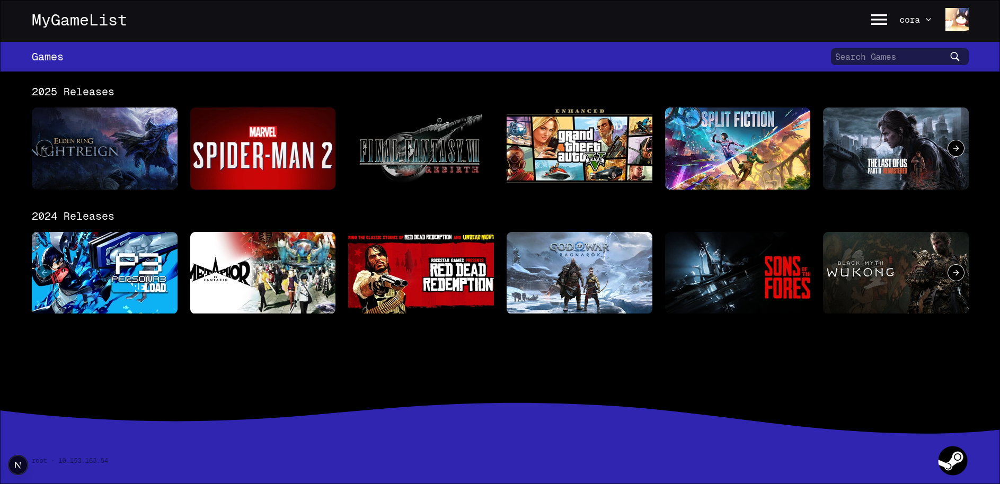
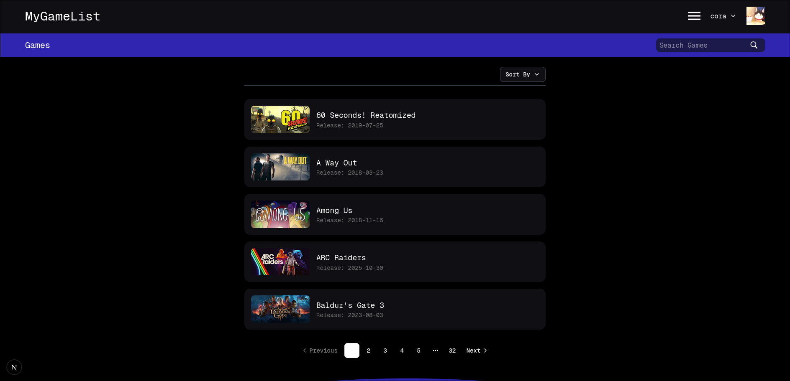
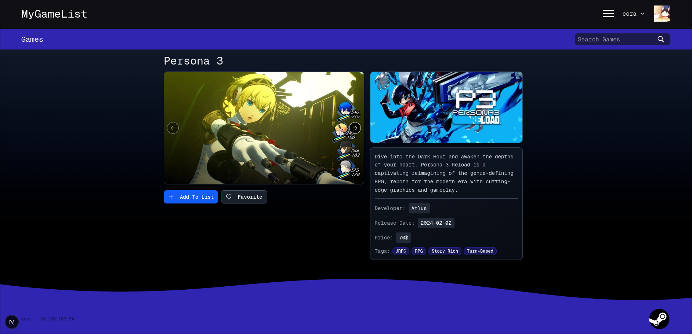
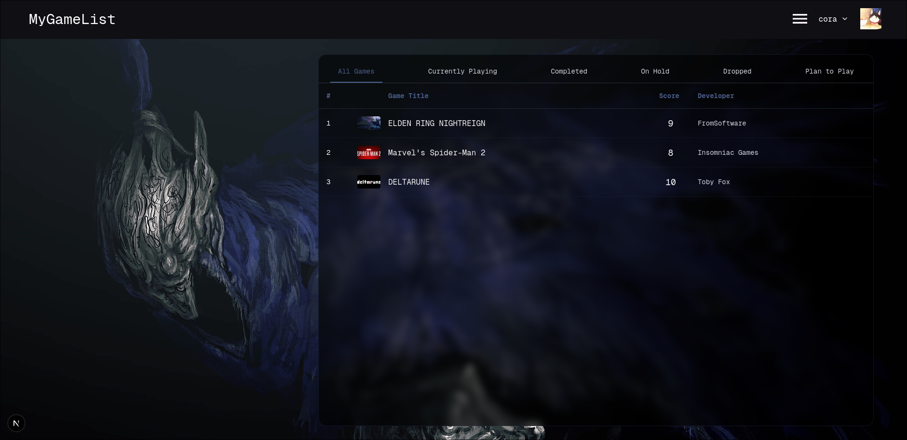
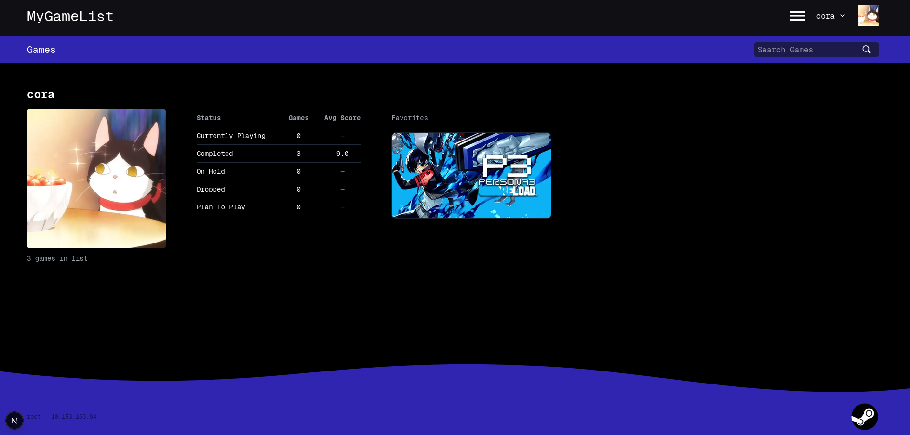
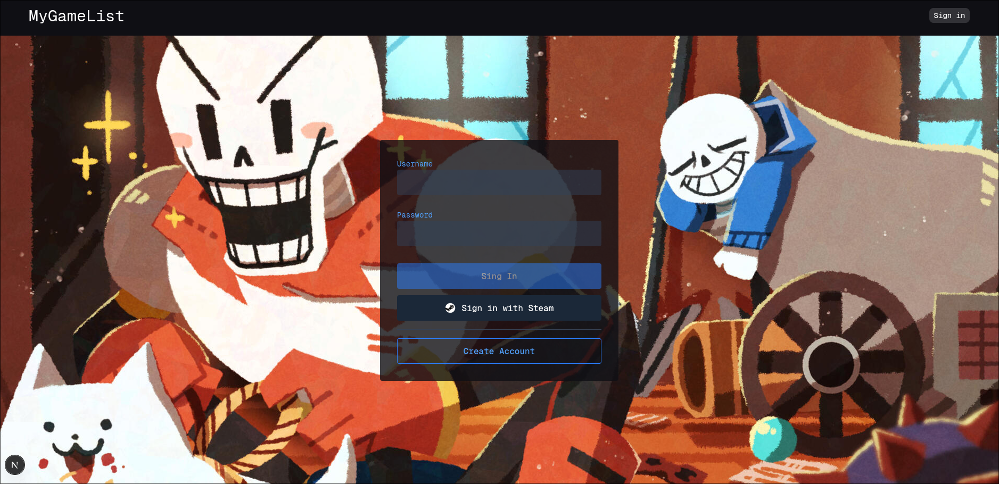

# Mygamelist

A web application that allows users to track and manage their gaming library.

## Dependencies

### Setup & Configuration

Configure the server via the [mygamelist-server](https://github.com/Reckless312/mygamelist-server) repository.

```bash
cp .env.template .env
```

*Note: Update the backend API and Steam API endpoints in `.env` as needed.*

## Application Overview

### Home Page



*Showcases the games from the past years.*

### Search Page



*Contains the whole library of available games.*

### Game Page



*Information about the game, with options to add to the user's personal list and mark as a favorite.*

### Personal List



*Tracked games for the current user.*

### Profile Page



*Stats about the user and personal favorites.*

### Login Page



*Simple login or authentication with Steam.*

## System Specifications

* **Frontend:** Next.js, http-cookies, shadcn/ui
* **Backend:** Express.js, Sequelize